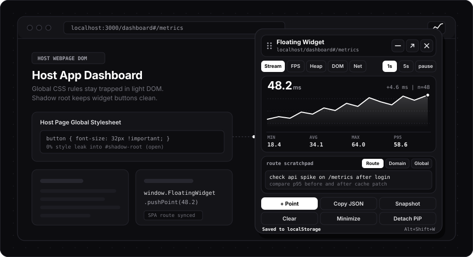

# floating-chart-widget




Ever injected a floating box on a random website and watched their global button CSS turn your UI into a circus, bhai? Shadow DOM fixes that headache forever.

Zero framework bloat, just drop one script tag or load unpacked in Chrome.

## what is this

* A tiny draggable dark card that floats on top of any webpage inside an open Shadow DOM.
* Plots a live SVG line chart with `min`, `avg`, `max`, and `p95` numbers right underneath.
* Reads browser FPS, JS heap size, DOM node count, network timing, or your own `pushPoint(42)` numbers.
* Saves quick plain notes in `localStorage` for each URL route, domain, or globally.
* Watches `pushState` and `replaceState` so SPA route clicks swap your notes in 0ms.
* Detaches into an always on top Chromium Picture in Picture window when your tab gets crowded.
* Remembers where you dragged it and never lets you yeet the card outside the screen.
* When I wrote the pointer clamp math on 3am chai, only me and bhagwan knew how it worked. Now only bhagwan knows, so tests guard it.

## run it in 60 sec

Clone and run tests (needs Node 18+, zero npm install drama):

```bash
git clone https://github.com/LevCodeLab/floating-chart-widget.git
cd floating-chart-widget
npm run build
npm test
```

Try the local CSS torture demo in your browser:

```bash
open demo/index.html
```

Or load the Chrome / Brave extension starter:

1. Open `chrome://extensions` in your browser.
2. Turn on **Developer mode** in the top right corner.
3. Click **Load unpacked** and pick the `extension/` folder.
4. Click the toolbar icon or press `Alt+Shift+W` on any tab.

Drop it onto any HTML page with one tag:

```html
<script src="./dist/floating-widget.js"></script>
<script>
  window.FloatingWidget.pushPoint(48.5);
</script>
```

## how to edit and customize

Everything lives in plain vanilla JS files. No webpack maze, no 400MB `node_modules` black hole. If a host page still breaks something, not a bug bhai, check if you mounted outside Shadow DOM.

* `src/floating-widget.js`: Main `FloatingChartWidget` class, Shadow DOM styles, SVG chart math, drag clamp logic, and SPA route watcher.
* `dist/floating-widget.js`: Ready to drop browser bundle built by `npm run build`.
* `extension/manifest.json`: Chrome Manifest V3 config with `activeTab`, `storage`, and `scripting` permissions.
* `extension/popup.html` & `extension/popup.js`: Monochrome popup menu to toggle the card, change live data mode, or reset coordinates.
* `extension/content.js` & `extension/widget.js`: Content script bridge that mounts the widget on active tabs.
* `demo/index.html`: Local sandbox with loud global CSS rules proving 0% style leak into the widget.
* `scripts/build.mjs`: Bundles `src/` into `dist/` and `extension/` plus builds the PNG icons.
* `test/floating-widget.test.mjs`: Node test suite for ring buffer stats, SVG path math, drag bounds, and theme color checks.

Custom mount options in JS:

```js
import { FloatingChartWidget } from "./src/floating-widget.js";

const widget = new FloatingChartWidget({
  title: "API Watch",
  initialSource: "custom",
  initialCadence: "pause",
  noteScope: "route",
  unit: "ms",
  capacity: 80
});

widget.mount();
widget.pushPoint(31.4);
```

## shortcuts and quick buttons

* `Alt+Shift+W`: Show or hide the widget anywhere on the page.
* `+ Point`: Push a fresh sample into the chart buffer.
* `Copy JSON`: Copy chart stats, points, and route notes to your clipboard.
* `Snapshot`: Download a `.json` dump of the current session.
* `Minimize`: Shrink the card into a tiny floating pill with a mini chart.
* `Detach PiP`: Pop the widget into a floating Chromium Picture in Picture window.

## license

MIT License. Copyright (c) 2026 LevCodeLab.
